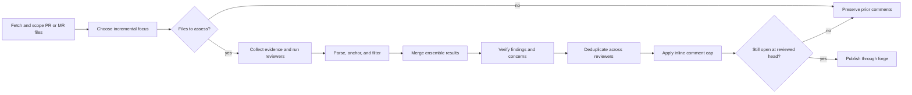

# A review run

`runReviews` produces one review per configured profile in parallel, removes
duplicate findings across profiles, then publishes each result. A single
`runReview` call uses the same produce and publish stages. The engine lives in
`packages/core/src/index.ts`; orchestration lives in
`packages/action/src/orchestrate.ts`.

## Pipeline

## Step by step

1. **Fetch and scope.** The forge reads PR/MR metadata, changed files, and
   convention docs. Paginated collections stop after 20 pages. Paths must match
   the reviewer's directories and include/exclude patterns. An empty scope
   produces no review writes.
2. **Choose focus.** A previous review marker identifies the last reviewed
   commit. The incremental delta controls which files may receive findings;
   the full in-scope diff remains context. A failed history lookup triggers a
   full review while preserving prior comments. See
   [First run vs later runs](./first-vs-incremental.md).
3. **Prepare context.** Agentic reviews with a checkout collect bounded source
   evidence by default. Small diffs accompany that evidence inline; larger
   diffs use a temporary file. Caller information and the mapping from working
   directory to repository-relative paths help the reviewer explore correctly.
4. **Run.** The selected harness receives the system and user prompts. An
   agentic error may retry once headless, retaining the full in-scope diff,
   focus list, and collected evidence. Quota and rate-limit errors fail without
   this retry. A rejected prompt-cache key retries once without the key.
5. **Parse and validate.** A recognizable review object may omit `summary`;
   unrelated JSON is rejected. An omitted or null `diagram` means no diagram.
   Findings are validated individually, scoped to reassessed files, anchored
   to diff lines where possible, and filtered by severity. Unanchorable
   findings become summary notes.
6. **Ensemble.** When configured, run each model and keep majority-agreed
   findings inline. Agreement includes text similarity, not just position.
   Failed models are reported; surviving models retain the original majority
   threshold. Minority findings appear in a lower-confidence summary section.
7. **Verify.** The verifier checks inline findings and PR-wide concerns against
   the full in-scope diff and evidence. If the review was agentic and a checkout
   exists, it can inspect surrounding code. Headless verification rejects
   claims requiring unavailable context. Invalid or failed verification keeps
   all findings and concerns and marks the run as degraded.
8. **Deduplicate and cap.** The orchestrator deduplicates the union of reviewers'
   inline findings. Then each review applies `maxComments`, ranking by severity.
   Overflow appears in the summary and still contributes to the verdict.
9. **Publish.** The forge rechecks the reviewed head and open state before
   publishing. Merged, closed, or changed-head reviews are skipped. The combined
   summary has a separate open-state check. A transient check failure allows
   publication and is logged. GitHub uses reviews and summary comments; GitLab
   uses positioned discussions and summary notes. Skipped reviewers preserve
   their earlier summary sections.

## Limits

| Knob | Default | Effect |
| --- | --- | --- |
| `maxTurns` | 10 | Agentic tool-loop cap, per reviewer or top level |
| `maxComments` | 10 | Inline cap; additional findings remain in the summary |
| headless cap | 10 | Safety cap for fallback and headless verification |
| `reasoning` | harness default | Native effort setting and a prompt note |

The repository's own reviewer configurations can override these defaults.
A turn-limit error can trigger the headless fallback. See
[GitHub objects](./github-objects.md) for posting details and
[GitLab setup](../gitlab.md) for the corresponding MR workflow.
